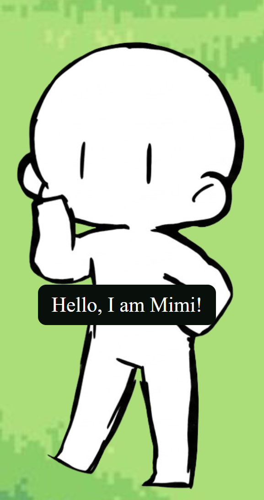
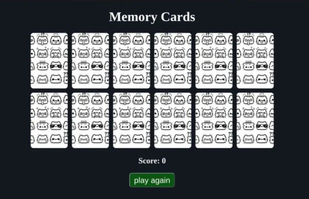

#MIMI-GAMES
collection of beginner friendly mini games to help our character mimi play,

#features
quick introduction with mimi
  

#game1: pacmi
Pac-Man, Mimi edition. Guide Mimi around the maze and eat everything in sight.
  
-Maze movement with arrow keys
-Collect dots to rack up points
-Dodge the ghosts, 
dont let the snakes get Mimi!

#game2: Mimi Drive, drive with Mimi.
  
Steer left and right
Avoid the other cars
One crash and it's game over

#game3: Mimi the Runner.
  
  An endless runner. Keep running and jump over the obstacles.
One-button jump
Obstacles keep coming
Survive as long as you can
inspo https://www.youtube.com/watch?v=lB_J-VNMVpE&t=12s

#game4: Snakey, eat all the apples.
The blue box is the snake and the red box is the apple.

Steer with the arrow keys
Eat apples to grow longer
Don't hit the walls or yourself 

#game5: Mimi's plane, dont get crashed!

Tap or press a key to fly up
Gravity pulls you down
Squeeze through the gaps without crashing
inspo:https://www.youtube.com/watch?v=Xw2MEG-FBsE

#game6: memory card, check mimis memory.
Flip the cards and match the pairs from memory.

Cards are shuffled every round
Flip two at a time to find a match
Matched pairs stay revealed and add to your score
Restart button to play again

